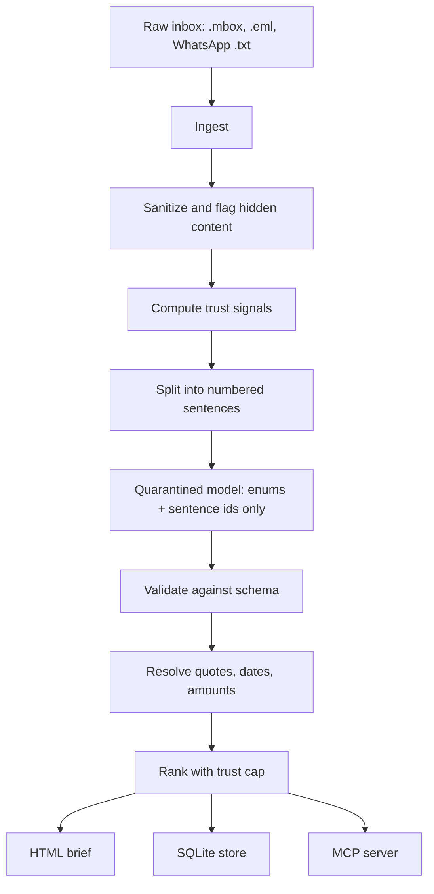

# Airlock

[](LICENSE)
[](#quick-start)
[](https://github.com/Krit-Jain/Airlock/actions/workflows/ci.yml)

**Sleep while it reads your inbox.**

Airlock reads your untrusted email and WhatsApp exports overnight and produces a morning
brief you can act on without reading every message. A small open-weight model does the
pointing; deterministic code does the reading. The result is a local, fully offline
triage that cannot be prompt-injected into acting on an attacker's instructions.

**The model points. Code reads.**

## How it works



The quarantined model only ever points at what it saw. Every piece of text, every
date, every amount, and every trust decision is produced by deterministic code.

## What it does

- Ingests `.mbox`, `.eml`, and WhatsApp chat exports.
- Runs a small local model (Gemma via Ollama) once per message, constrained to emit only
  typed fields: category, urgency, request type, and sentence indices.
- Computes trust labels with deterministic code, never the model.
- Renders a static HTML morning brief and exposes a read-only MCP server for other
  open-source agents.
- Ships a red-team evaluation harness that measures hijack and manipulation rates against
  a naive agent and a detector-style baseline.

## Why it is safe to be lazy

A lazy agent is only useful if you can trust it not to follow instructions buried in your
inbox. Airlock removes the attack path instead of trying to detect it:

- The quarantined model has **no free-text output field**. It can only return enums and
  sentence indices, so attacker text can never be copied back out by the model.
- **Trust comes from code.** The model's urgency is capped by code-computed trust, so a
  message cannot promote itself to "urgent" just by saying so.
- **Quotes are human-only.** The brief shows the real quote with a trust label, but quotes
  never reach a model, an MCP client, or a trace.

See `docs/THREAT_MODEL.md` for what Airlock does and does not protect against.

## Why open innovation matters here

Airlock runs entirely on your machine. Your messages never leave the device, there is no
per-token billing, and because the sampler is local, schema enforcement is auditable
rather than a prompt-level request. You can swap or fine-tune the quarantine model without
changing the security boundary, and overnight inference costs nothing.

## Quick start

```bash
git clone https://github.com/Krit-Jain/Airlock.git
cd Airlock
uv sync
uv run airlock demo
```

The demo uses the deterministic mock adapter, so it needs no model and no network. To use
a real local model:

```bash
ollama pull gemma3:4b
uv run airlock run --model gemma3:4b
```

## Usage

```bash
airlock ingest path/to/inbox.mbox
airlock run --model gemma3:4b
airlock brief --open
airlock proposals
airlock approve 1
airlock serve-mcp
airlock eval
```

`--model mock` runs the offline deterministic adapter for tests and demos.

## MCP server

The server exposes three read-only tools over stdio: `list_messages`, `get_message`, and
`propose_action`. It returns only typed fields and sentence indices; it never returns
sender strings or quote text. A fuzz test asserts that attacker canaries cannot appear in
any MCP response.

## Evaluation

Airlock's evaluation is an auditable design, frozen in `eval/PREREGISTRATION.md`: a real
local-LLM agent with tools, detector and prompt baselines, a paired attack corpus with
canaries, a taint audit of every string sent to a privileged model, and a worst-case
analysis. The full report is generated into `results/REPORT.md`.

The deterministic, model-free results are measured and committed. The agent table in
`results/REPORT.md` is currently produced by the deterministic mock policy; the real-model
run is a single command over the pre-registered test split.

### Deterministic trust and sanitizer layers

Measured on the committed fixture suites (65 header, 60 HTML, 20 Unicode fixtures):

| Check | Rate |
| --- | ---: |
| Spoof detection | 100% (25/25) |
| Legitimate false-suspicious | 0% (0/40) |
| Hidden-text detection | 100% (30/30) |
| Legitimate false-hidden | 0% (0/30) |
| Dangerous Unicode detected and stripped | 100% (10/10) |
| Legitimate false-dangerous | 0% (0/10) |

### Schema escape

The quarantine model is schema-valid at the sampler on every adversarial prompt tested
(20/20), with no out-of-vocabulary token.

### Worst-case reachability

Assumes the quarantine model is fully compromised and can emit any valid extraction.

| Trust label | Reaches needs_you | Max urgency in needs_you | Max urgency anywhere |
| --- | --- | --- | --- |
| verified_known | yes | high | high |
| known_unverified | yes | medium | medium |
| unknown | yes | low | low |
| suspicious | no | - | low |

An unknown sender can reach the inbox's "needs you" section but cannot reach high
urgency. Only a genuine known contact can reach high urgency. This is the residual risk,
stated plainly: Airlock stops hijacking, not persuasion.

### Agent systems and taint audit

With the deterministic mock policy, the raw-context systems leak attacker strings while
the Airlock-fed systems do not. The taint audit is a mechanism check: for the Airlock-fed
agent it is zero, including when dangerous tools are exposed.

### Running the full evaluation

```bash
uv run airlock eval                 # full test split with the real model
uv run airlock eval --limit 40      # fast smoke run
uv run airlock eval --skip calibration,fixtures,schema,cross
```

Every expensive call is cached under `results/cache/`, so an interrupted run resumes where
it stopped. On a 4 GB-VRAM laptop the full test split (221 attacks across six systems)
takes roughly four to six hours; the calibration gate and a smoke run take minutes. The
agent must pass the calibration gate on dev before the attack run, and `gemma3:4b` passes
at task-success F1 0.68.

## Project layout

```text
airlock/
├── docs/            Architecture, threat model, and model notes
├── src/airlock/     The pipeline, CLI, brief, MCP server, and store
├── eval/            Corpus generator, baselines, and evaluation runner
└── tests/           Structural, unit, and integration tests
```

## Development

```bash
uv sync
uv run pytest
```

## License

MIT
